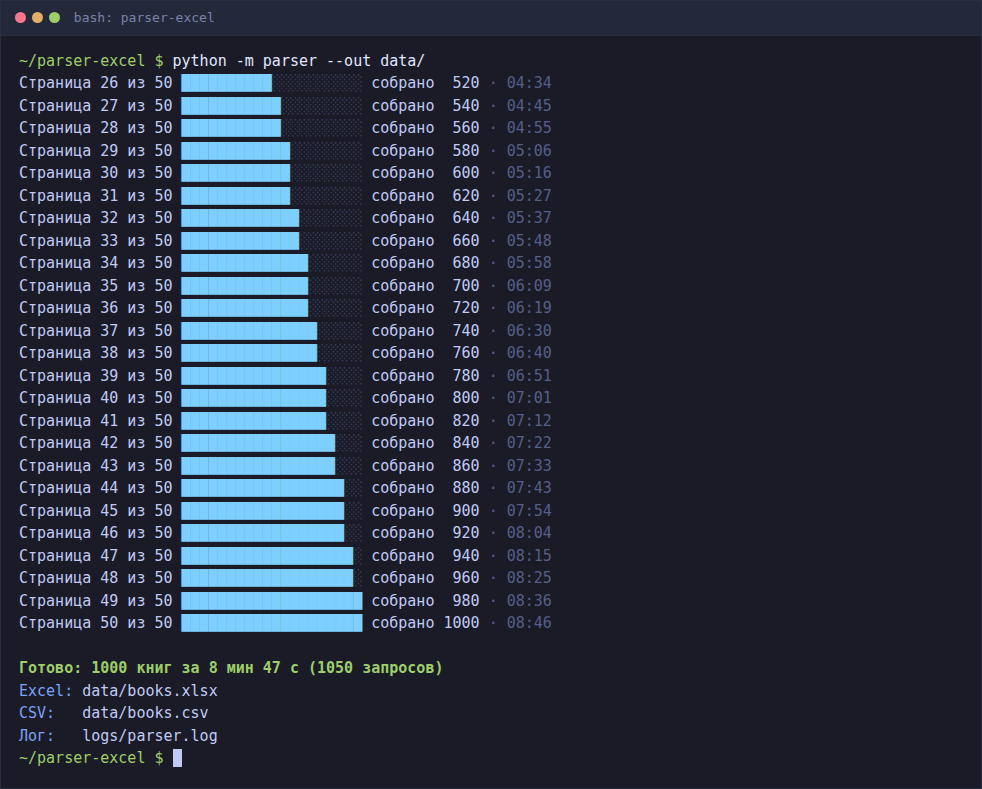
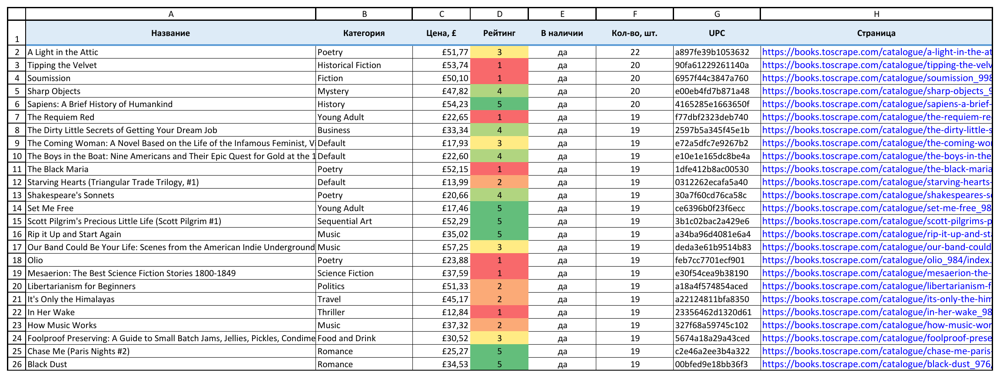
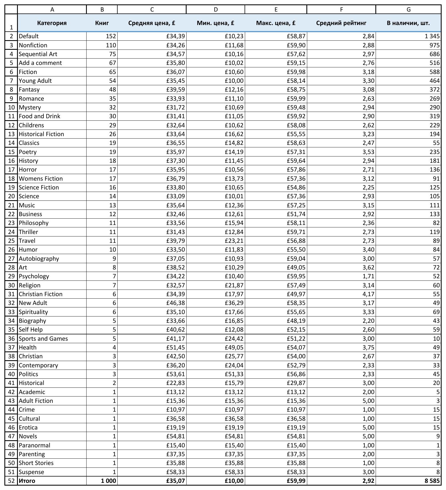

# Парсер каталога → Excel

Собирает весь каталог учебного книжного магазина [books.toscrape.com](https://books.toscrape.com) (1000 книг на 50 страницах) и сохраняет его в Excel с листом-сводкой по категориям и в CSV. Сайт сделан специально для практики парсинга, сбор с него разрешён.

```
python -m parser --out data/
```



## Что умеет

- Обходит 50 страниц каталога по ссылке «next» и открывает страницу каждой книги.
- По каждой книге собирает название, категорию, цену, рейтинг (звёзды → число 1-5), наличие и точное количество, UPC, ссылку на страницу и ссылку на обложку.
- Обходит сайт вежливо: запросы стартуют не чаще одного раза в 0,5 с (задержка по умолчанию задана в `parser/config.py`, флаг `--delay` принимает от 0,5 до 10 с), одновременно идёт не больше 2-3 запросов, в заголовках свой `User-Agent`.
- Повторяет запрос при сетевой ошибке и ответах 429, 500, 502, 503, 504: 3 повтора с паузой 2, 4 и 8 с, заголовок `Retry-After` учитывается.
- Не теряет книгу, если её страница так и не загрузилась: книга остаётся в выгрузке с данными из каталога, а в консоли и логе виден счётчик таких книг.
- Сохраняет уже собранное, если упала страница каталога, случился непредвиденный сбой (трассировка уходит в лог) или прогон прерван через Ctrl+C.
- Пишет `books-<дата-время>.xlsx` рядом, если `books.xlsx` открыт в Excel и Windows не даёт его перезаписать.
- Показывает прогресс в консоли («Страница 12 из 50, собрано 240»), в конце пишет число книг, время и пути к файлам.
- Пишет каждый запрос с кодом ответа и временем в `logs/parser.log`, повторы и ошибки там же.

Полный проход при проверке занял 8 мин 47 с: 1050 запросов (50 страниц каталога и 1000 страниц книг) при задержке 0,5 с, без единого повтора. С `--delay 1.0` выйдет около 18 минут, для быстрой проверки есть `--limit`.

## Почему данные берутся со страницы книги

На странице каталога нет категории, UPC и точного количества: там только «In stock». Категория есть ещё при обходе по категориям, но UPC и количество всё равно лежат только на странице книги. Значит, 1000 запросов к страницам книг нужны в любом случае, а на странице книги есть и категория (в «хлебных крошках»). Обход по категориям потребовал бы 80 страниц списков вместо 50 (в 50 категориях страницы делятся по 20 книг) и не дал бы ни одного нового поля. Поэтому каталог используется только чтобы найти книги и как запасной источник, если страница книги не открылась.

## Что в файлах

**`data/books.xlsx`**, лист «Книги»:
- шапка жирным на цветном фоне, строка закреплена, на всех колонках автофильтр;
- ширина колонок подобрана по содержимому, длинные ссылки ограничены;
- цена числом в денежном формате с £ и двумя знаками, её можно суммировать и сортировать;
- рейтинг числом 1-5 с цветовой шкалой условного форматирования: 1 красный, 3 жёлтый, 5 зелёный;
- ссылки на страницу и обложку кликабельные.



*Настоящий рендер Excel: лист экспортирован в PDF самим Excel (печатный вид с сеткой и заголовками) и обрезан до таблицы.*

**`data/books.xlsx`**, лист «Сводка»: по каждой категории число книг, средняя, минимальная и максимальная цена, средний рейтинг и сколько всего экземпляров в наличии. Категории отсортированы по числу книг. Значения по категориям посчитаны при выгрузке, итоговая строка считается формулами Excel (`=SUM`, `=AVERAGE`, `=MIN`, `=MAX`). Средняя цена и средний рейтинг в итоге берутся по листу «Книги», а не как среднее средних: у категорий разный размер, и среднее средних дало бы неверную цифру. Автофильтр не захватывает итоговую строку, поэтому сортировка её не сдвигает. «Default» и «Add a comment» не ошибка разбора: так эти категории называются в меню самого сайта.



*Лист «Сводка», настоящий рендер Excel тем же способом; итоговая строка посчитана формулами самого Excel.*

**`data/books.csv`**: те же колонки в UTF-8 с BOM, поэтому Excel открывает кириллицу и знак £ без кракозябр. По умолчанию разделитель `;` и десятичная запятая: так файл по двойному щелчку раскладывается по колонкам в Excel с русскими региональными настройками. Флаг `--csv-format std` даёт классический CSV с `,` и точкой для скриптов и импорта в базы.

## Запуск

Нужен Python 3.10 или новее.

Linux, macOS, WSL:

```bash
python3 -m venv .venv
.venv/bin/pip install -r requirements.txt
.venv/bin/python -m parser --out data/
```

Windows:

```bat
py -m venv .venv
.venv\Scripts\pip install -r requirements.txt
.venv\Scripts\python -m parser --out data/
```

| Флаг | По умолчанию | Что делает |
|------|--------------|------------|
| `--out` | `data/` | папка для `books.xlsx` и `books.csv` |
| `--limit N` | весь каталог | собрать только первые N книг |
| `--delay` | `0.5` | пауза между стартами запросов, секунды, не меньше 0,5 |
| `--concurrency` | `2` | сколько страниц книг грузить одновременно, 1-3 |
| `--csv-format` | `ru` | `ru`: `;` и запятая, `std`: `,` и точка |
| `--log` | `logs/parser.log` | файл лога |

Таймаут, число повторов, паузу перед повтором и `User-Agent` меняют в `parser/config.py`.

Код выхода: `0` весь каталог собран, `1` обход остановился из-за ошибки (собранное сохранено), `130` прервано через Ctrl+C (собранное сохранено).

## Тесты

```bash
.venv/bin/pip install -r requirements-dev.txt
.venv/bin/python -m pytest
```

95 тестов, сеть не нужна. Разбор проверяется на страницах сайта, сохранённых в `tests/fixtures/`: каталог (первая, вторая и последняя страница), страница книги. HTTP подменяется фиктивным транспортом `httpx.MockTransport`, который отдаёт эти страницы.

Что проверяют тесты:
- разбор каталога: 20 книг, полное название из атрибута `title` вместо обрезанного текста, абсолютные ссылки, «нет в наличии»;
- пагинация: номер страницы, всего страниц, ссылка на следующую, последняя страница без неё;
- страница книги: все поля, включая категорию, UPC и точное количество;
- рейтинг словом → число, наличие, цена, ошибка разбора на чужой разметке;
- загрузчик: повторы при 5xx и сетевой ошибке с растущей паузой, `Retry-After`, 404 без повторов, декодирование UTF-8 без charset в заголовке, интервал между стартами запросов при параллельной работе;
- обход: `--limit` посреди второй страницы, запасные данные при упавшей странице книги, остановка с сохранением собранного при упавшей странице каталога, свой `User-Agent`;
- Excel: листы, жирная закреплённая шапка, автофильтр, денежный формат, ссылки, цветовая шкала рейтинга, ширина колонок, значения и формулы сводки, пустая выгрузка;
- CSV: BOM, оба формата, кавычки и `;` внутри названия;
- запуск из консоли целиком на фиктивном сайте: файлы, лог, вывод, коды выхода, проверка флагов.

## Как сделаны скриншоты

Окна не открывались. Консоль снята безголовым Chromium через Playwright скриптом `tools/screenshots.py`, листы Excel отрендерены самим Excel без окна (см. ниже).

- Консоль: настоящий вывод полного прогона (сохранён через `tee`), отрисованный моноширинным шрифтом на тёмном фоне. Кадр «во время» показывает начало этого вывода, кадр «после» показывает последние 30 строк, как в окне терминала, прокрученном до конца.
- Листы Excel: настоящий рендер. Скрытый экземпляр Excel открывает `books.xlsx` только на чтение, экспортирует лист в PDF (печать с сеткой и заголовками строк и столбцов), PDF переводится в PNG (`pdftoppm`) и обрезается по таблице. Скрипт `tools/screenshots.py` умеет и HTML-отрисовку листов, если Excel под рукой нет.

Снимки сделаны с полного прогона всего каталога, он занял 8 мин 47 с.

Сам файл проверялся тестами через openpyxl. В настольном Excel вручную он не открывался.

```bash
.venv/bin/pip install -r requirements-dev.txt
.venv/bin/python -m playwright install chromium   # если браузера ещё нет
.venv/bin/python -m parser --out data/ | tee data/console.txt   # вывод консоли для снимков
.venv/bin/python tools/screenshots.py              # читает data/, пишет shots/
```

## Структура

```
parser/
  __main__.py       запуск через python -m parser
  cli.py            флаги, логирование, порядок работы, коды выхода
  config.py         настройки по умолчанию: задержка, параллельность, повторы, User-Agent
  fetcher.py        загрузчик: ограничение частоты, параллельность, повторы
  parsing.py        разбор страниц каталога и книги (чистые функции)
  models.py         модель данных: ListItem, ListPage, Book
  crawler.py        порядок обхода, запасные данные, итог обхода
  summary.py        статистика по категориям
  table.py          колонки выгрузки, общие для Excel и CSV
  export_excel.py   выгрузка в Excel
  export_csv.py     выгрузка в CSV
  console.py        прогресс и итог в консоли
tests/
  fixtures/         сохранённые страницы сайта
  test_*.py         тесты
tools/
  screenshots.py    скриншоты для README
shots/              скриншоты
```

## Стек

Python 3.10+, `httpx` (асинхронный клиент), `beautifulsoup4`, `openpyxl`, `pytest`. Для скриншотов `playwright`.

## Ограничения

- Селекторы написаны под разметку books.toscrape.com. Для другого сайта переписываются `parsing.py` и адреса в `config.py`, загрузчик, обход и выгрузки остаются.
- Docker-образа нет: программа запускается одной командой в обычном Python-окружении.
